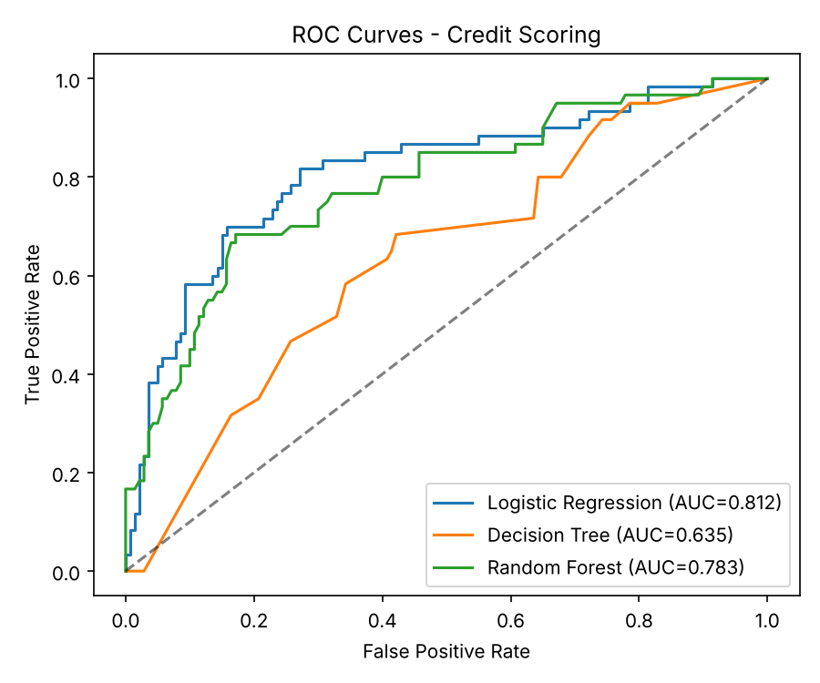
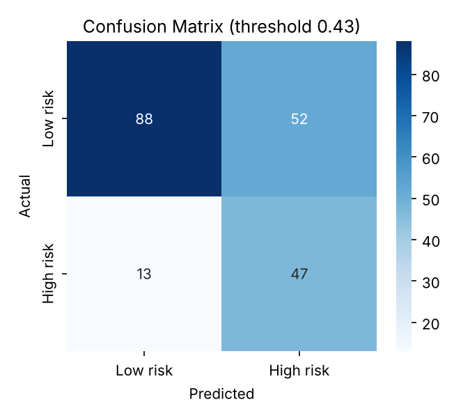
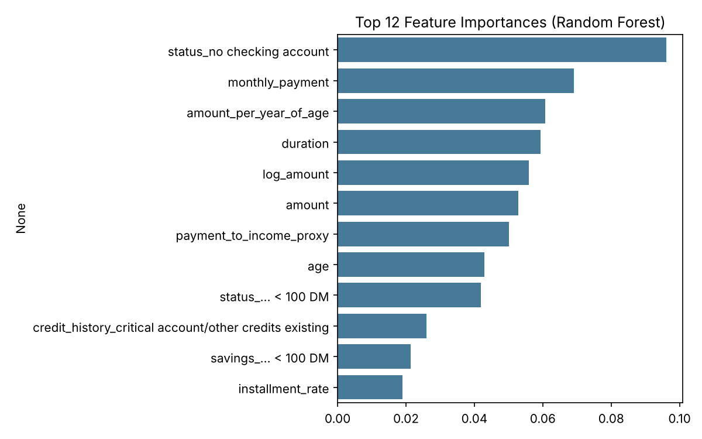
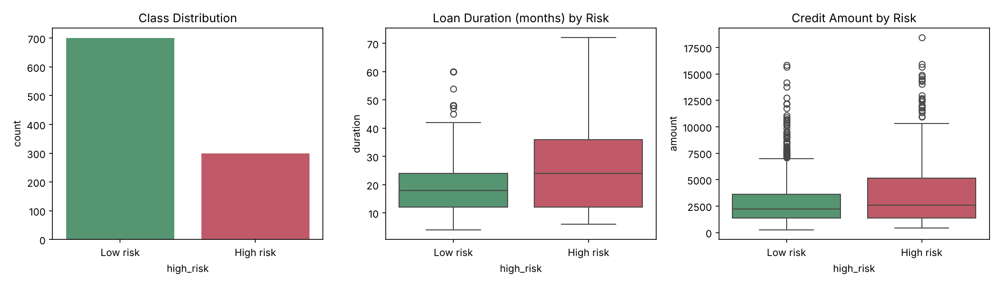

# CodeAlpha Task 1: Credit Scoring Model

Machine Learning Internship project for [CodeAlpha](https://www.codealpha.tech).

## Objective
Predict an applicant's creditworthiness from past financial data. The model flags **high-risk** applicants (likely to default) so a lender can decide whether to approve a loan.

## Dataset
**German Credit Data** (Statlog, UCI ML Repository). A copy is included in `data/german_credit.csv`.
- 1,000 applicants, 20 features: checking account status, credit history, loan purpose, credit amount, savings, employment duration, installment rate, age, housing, job, etc.
- Target: `high_risk` = 1 for bad credit (300 applicants, 30%), 0 for good credit (700, 70%)
- No missing values. Classes are imbalanced, so `class_weight="balanced"` is used.

## Approach
1. Exploratory analysis (class balance, loan duration and amount by risk)
2. **Feature engineering** from financial history:
   - `monthly_payment` = amount / duration (repayment burden)
   - `payment_to_income_proxy` = monthly payment x installment rate
   - `amount_per_year_of_age`, `log_amount`
   - `long_loan` (> 24 months), `young_borrower` (< 25)
3. Preprocessing: standard scaling for numeric columns, one-hot encoding for categorical columns
4. Stratified 80/20 train/test split
5. Models: **Logistic Regression, Decision Tree, Random Forest**
6. Evaluation: Precision, Recall, F1-Score, ROC-AUC, plus 5-fold cross-validation
7. Random Forest hyperparameter tuning (GridSearchCV) and decision-threshold analysis

## Results (test set, 200 applicants, high-risk class = positive)

| Model | Accuracy | Precision | Recall | F1-Score | ROC-AUC | CV ROC-AUC |
|---|---|---|---|---|---|---|
| Logistic Regression | 0.750 | 0.557 | 0.817 | 0.662 | 0.812 | 0.765 |
| Decision Tree | 0.605 | 0.402 | 0.650 | 0.497 | 0.635 | 0.698 |
| Random Forest | 0.785 | 0.635 | 0.667 | 0.650 | 0.784 | 0.793 |

**Tuned Random Forest** (`max_depth=8, n_estimators=400`), default threshold 0.50:
accuracy 0.77, high-risk precision 0.60, recall 0.72, F1 0.65, **ROC-AUC 0.807**.

**Threshold trade-off:** lowering the threshold to 0.43 (chosen by cross-validation on training data) raises high-risk recall to 0.78 but drops precision to 0.47. A lender who prefers to avoid missed defaults can accept this, while one who does not want to reject good customers would keep 0.50. The right choice depends on the relative cost of a default versus a lost customer.

**Most important features:** checking account status, monthly payment, amount per year of age, loan duration and credit amount. Three of the top features are engineered ones.

### Plots
| | |
|---|---|
|  |  |
|  |  |

## Run it yourself
```bash
git clone https://github.com/<your-username>/CodeAlpha_CreditScoring.git
cd CodeAlpha_CreditScoring
pip install -r requirements.txt
python credit_scoring.py
```
Plots, the metrics table and the trained model (`credit_model.joblib`) are saved to `outputs/`.

## Limitations
- Only 1,000 rows, so metrics vary with the train/test split (this is why cross-validation scores are shown too).
- The dataset has no income column, so a payment-to-income proxy is used instead.
- Educational project, not for real lending decisions. Credit models should also be checked for fairness (e.g., on age and gender).

## Author
Your Name | [LinkedIn](https://linkedin.com/in/your-profile)
